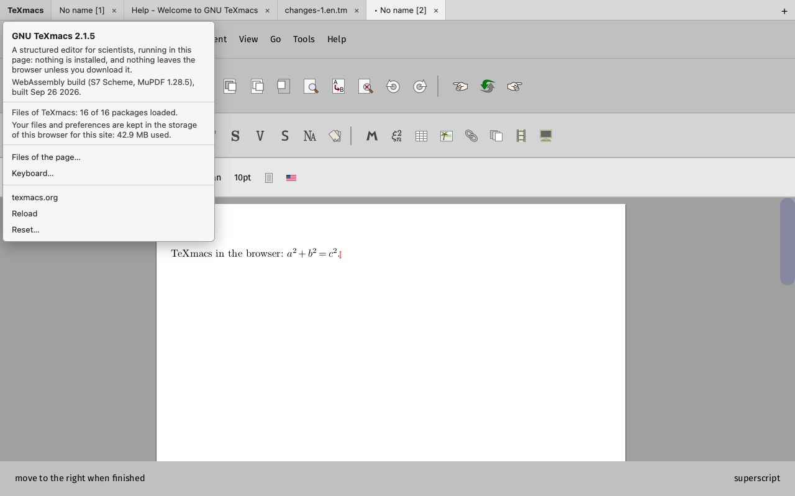
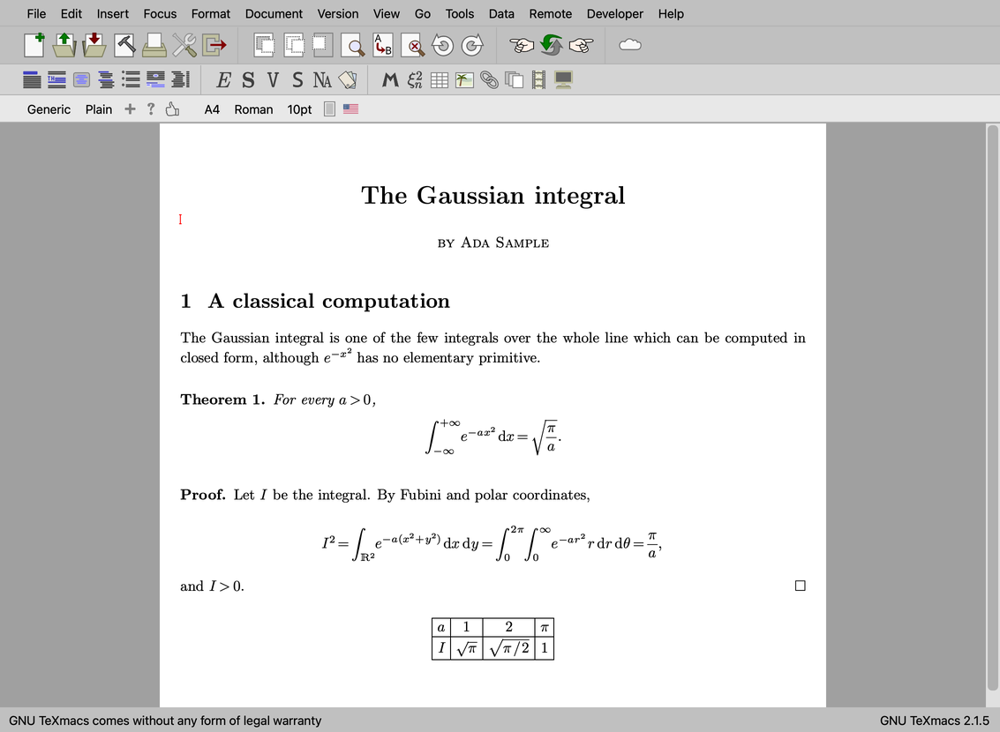
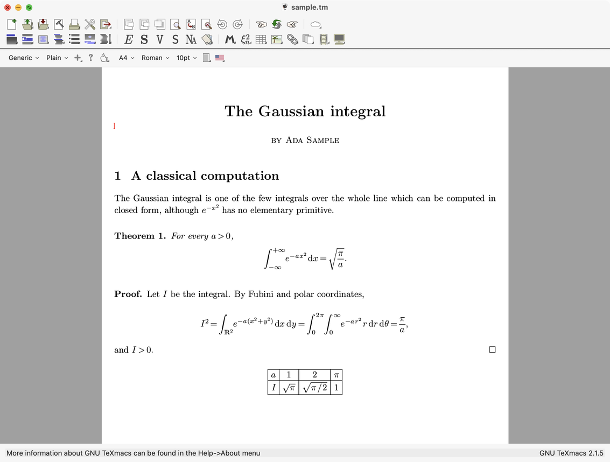
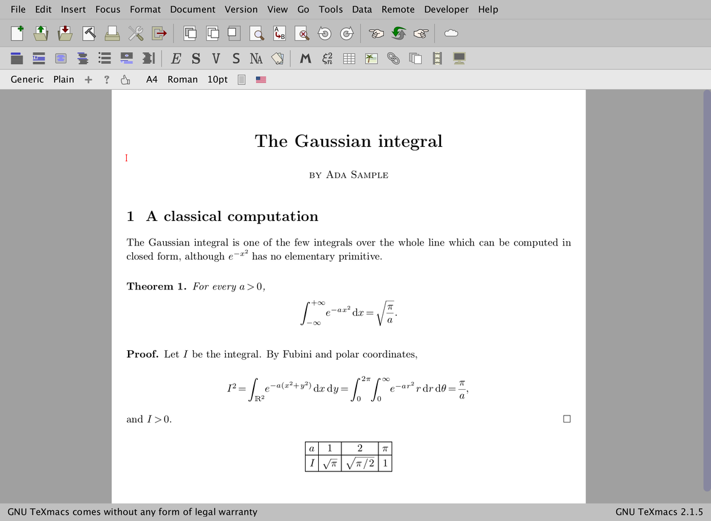
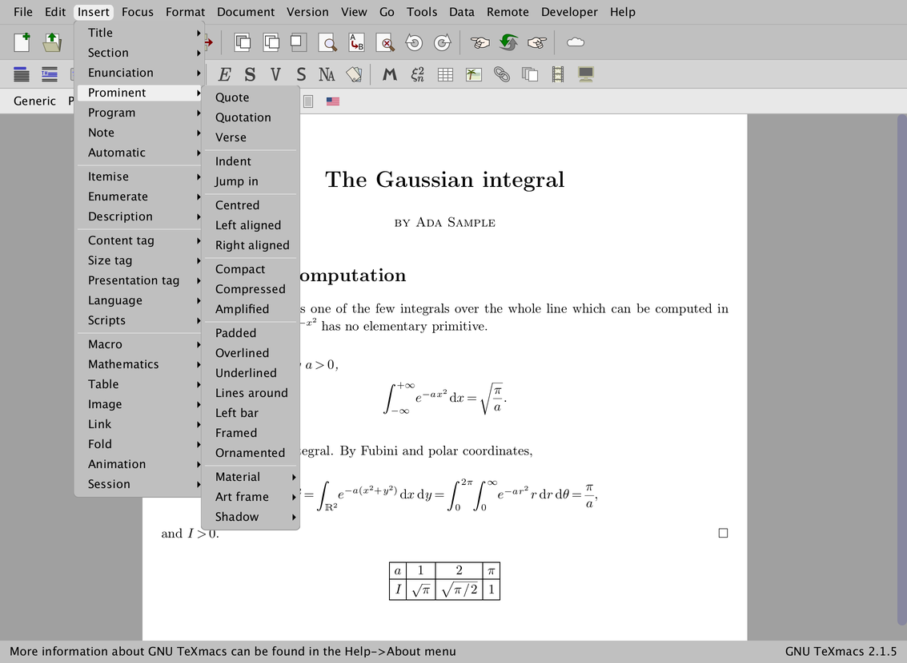
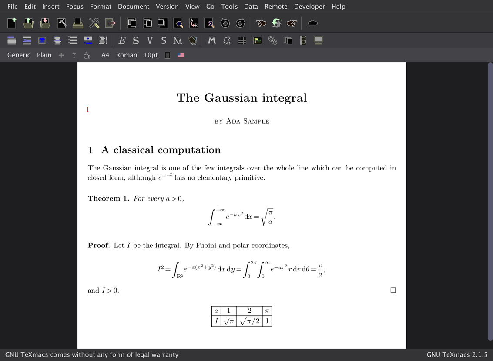
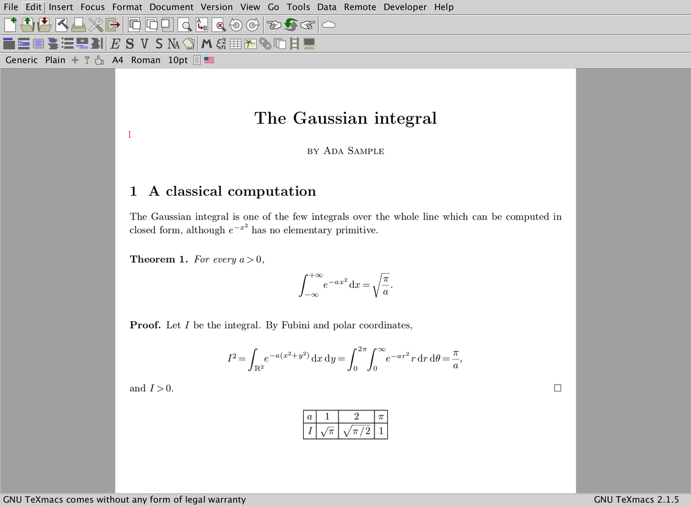

# TeXmacs Upsilon — branch `upsilon_texmacs`

This is **TeXmacs Upsilon**, an enhanced and bleeding-edge version of
[GNU TeXmacs](https://texmacs.org) with experimental features: it gathers
in one tree several lines of work which are not (yet) in the official
TeXmacs, so that they can be built, used and tested together.

**See it in pictures: [src/docs/upsilon-screenshots.md](src/docs/upsilon-screenshots.md)**
(also on the site, <https://mgubi.github.io/texmacs/features.html>, next to
the [latest builds](https://mgubi.github.io/texmacs/)).
What changed lately, the newest first:
**[src/docs/upsilon-changes.md](src/docs/upsilon-changes.md)** (also on the
site, <https://mgubi.github.io/texmacs/changes.html>). The people who
reported problems or sent code: **[src/TeXmacs/doc/about/welcome/upsilon-thanks.md](src/TeXmacs/doc/about/welcome/upsilon-thanks.md)**.

It is stock TeXmacs (the `svn_sync` branch, the mirror of the SVN trunk)
plus the following branches, merged in:

| Branch | What it brings |
|---|---|
| `wip_fixes` | **Fixes of TeXmacs which are not upstreamed**: bugs reported on Savannah and in the issues of this repository (the Scheme bridge, LaTeX import and export, BibTeX, the Qt list views, the editing modes, the keyboard maps, Windows paths, ...), **incremental typesetting** (only what an edit changed is typeset again, with caches of the typing), caches of styles and files which follow the files on disk, header dependencies in the autotools build, and the test suites below |
| `wip_opentype` | **OpenType mathematics**: formulas laid out from the `MATH` table of any OpenType math font, stretchable delimiters and accents from the font's own variants and assemblies, the OpenType features of text fonts, profiles which pair two dozen math fonts with their text companions (most of them shipped), a font inspector, and the weights and variants of a family (Format ▸ Weight) — see [OPENTYPEMATH.md](src/docs/OPENTYPEMATH.md) |
| `wip_more_fonts`, `wip_font_design` | **More fonts and a font design page**: the fonts of the ConTeXt distribution which were missing (DejaVu, Gentium Plus, the Antykwas, Iwona, Kurier, the weights of IBM Plex...), a font menu by design, and a page with a tab for each part of a document (text, mathematics, sans serif, typewriter, blackboard bold, calligraphic, fraktur) which shows samples of the fonts, applies the choice to the document and saves named choices |
| `wip_other_guis` | **Other graphical interfaces and GUI improvements**: Vue (a toolkit of its own, on Clay and SDL3, drawn by the GPU or by MuPDF), a native Cocoa interface for macOS, SDL and Qtwk, fixes to X11, and changes which serve every interface (the MuPDF renderer, windows which stay above the editor windows, ...) — see [the graphical interfaces](#the-graphical-interfaces) below |
| `wip_icons` | **Icon sets**: besides the original icons (classical), a monochrome set in the manner of the macOS symbols and a neo-classical set, the classical compositions modernized, which is the default, and the [Lucide](https://lucide.dev) icons; chosen in Preferences ▸ General ▸ Icon set — see [src/docs/icons/README.md](src/docs/icons/README.md) |
| `wip_s7` | **TeXmacs on [s7](https://ccrma.stanford.edu/software/snd/snd/s7.html)** instead of Guile 1.8: the interpreter is a build option (`./configure --with-scheme=s7\|femtolisp\|guile`), s7 (vendored, 11.9) is the default and needs no Guile at all; one Scheme code base serves all of them, and with s7 the first window is ready in about 0.7 s instead of 1.9 s — see [src/docs/s7/](src/docs/s7/README.md) |
| `wip_other_schemes` | **TeXmacs on [femtolisp](https://github.com/JeffBezanson/femtolisp)**, a third interpreter, experimental (`./configure --with-scheme=femtolisp`, and `SCHEME=femtolisp` for the browser): a small vendored Scheme which works on the byte strings of TeXmacs directly, with modules made of renamed global names, compiled files kept in a cache and function bodies compiled when first called; it starts about as fast as s7 and is faster on conversions such as the LaTeX export — see [src/docs/femtolisp/](src/docs/femtolisp/README.md) and the developer chapter *The femtolisp Scheme interpreter* |
| `wip_git` | **Git support**: Version ▸ Git with a side panel, a commit dialog, clickable status, log and branch pages, branches, tags and stashes, fetch, pull, push and clone in the background, comparison with any revision, a simple mode of snapshots, and **structured three-way merges of TeXmacs documents** (also as a git merge driver), with Git never run in a folder until it is trusted — see the manual chapter *Working with Git* and [src/docs/git-features.md](src/docs/git-features.md) |
| `wip_zotero` | **Citations from [Zotero](https://www.zotero.org)**, read from the Zotero desktop application (its local API): the search window of citations lists the references of Zotero after those of the `.bib` file or of the database, with their sources; keys completed from Zotero; a bibliography file written from Zotero, or Zotero as a source of the database, whose copies of Zotero items follow Zotero (with a field-by-field choice when both sides changed); keys renamed in Zotero followed in the citations; group libraries — see the manual page *Citations from Zotero* and [src/docs/zotero-design.md](src/docs/zotero-design.md) |
| `wip_csl` | **Bibliography styles of the [Citation Style Language](https://citationstyles.org)** (the styles of Zotero, Mendeley and Pandoc), processed by TeXmacs itself in Scheme: a bibliography whose style is `csl-apa`, `csl-ieee`, `csl-chicago-notes-bibliography`... is formatted by the `.csl` file, and so are the citations: numbers, authors and years with their disambiguation (2001a, 2001b) and grouping, or footnotes with the short forms of later citations; 13 styles come along, any other one is put next to the document — see the manual page *Compiling a bibliography* and [src/docs/csl-design.md](src/docs/csl-design.md) |
| `wip_markdown`, `wip_office` | **New converters**: import and export of **Markdown** (CommonMark and GitHub flavoured, formulas, tables, footnotes) and of the documents of **Word** (`.docx`) and **OpenDocument** (`.odt`): structure, tables, formulas through MathML and the formulas of Word, images and drawings, numbers and references, theorems, bibliography, and the formatting by hand, kept by a style `office` — see the manual pages *Converters for Markdown* and *Converters for Word and OpenDocument* |
| `wip_ts`, `wip_lsp` (through `wip_code`) | **Program code**: the syntax of 22 languages by **[tree-sitter](https://tree-sitter.github.io)** (its runtime vendored, its generator brought to Scheme), for source files, the code blocks of documents and the inputs of sessions: colours, folds, an outline, structural selection and moves, brackets, indentation, comments; and a client of **language servers** (LSP) for source files, opened in tabs of their own: diagnostics, completion, hover, signatures, references, renaming, fixes, formatting and symbols, a code block of a document being a document of its server too. Each works without the other, and a build without either is the TeXmacs above — see the manual pages *Editing program code*, *Editing source files* and *Language servers for source code*, [src/docs/code-features.md](src/docs/code-features.md) and [src/docs/tree-sitter.md](src/docs/tree-sitter.md) |
| `ai-sessions-port` | **AI sessions**: chats with ChatGPT, Claude, Gemini, Mistral, Ollama, OpenRouter and Albert inside a document, with streamed answers, files attached to the questions, the costs, and the keys kept in an encrypted wallet — see the help of the AI plug-in |
| `wip_wasm_vue` | **TeXmacs in the browser**: the same TeXmacs compiled to WebAssembly with Emscripten, on the Vue interface and s7, drawn by the GPU (WebGPU, by default in the browsers of Chromium, or WebGL2, with ThorVG) or by MuPDF; the files kept in the browser, and plug-ins whose programs run in the page too (Python by Pyodide, R by webR, TikZ by TikZJax, Asymptote, JavaScript, AI) — see [TeXmacs in the browser](#texmacs-in-the-browser) below |
| `wip_dev_docs` | **Extensive developer documentation**, inside TeXmacs (Help ▸ Developer documentation): some 400 pages, about 250 of them on the internals of the source code — the data types, the typesetter, fonts and OpenType, the Scheme interpreters, the server, buffers, views and windows, the editor, the GUI ports, converters, plug-ins, collaboration — which compile into a book of more than a thousand pages ([`src/TeXmacs/doc/devel/`](src/TeXmacs/doc/devel/)) |
| (tests, with `wip_fixes`) | **More tests**: unit tests of the kernel in C++ (which run without Qt too), nearly sixty Scheme test suites for editing, conversions, the typesetter, menus, links and more, regression tests on documents, a headless typesetting of the whole documentation, and the OpenType renders — see [src/tests/README.md](src/tests/README.md) |

Until 18 October 2026 it was called *Max's TeXmacs*, on the branch
`maxs_texmacs` (with the CI branch `maxs_ci` and the pre-release
`maxs-latest`); these were removed on 19 October 2026, their history being
that of `upsilon_texmacs`.

The branches are merged, not rebased, so each one can still be followed,
updated and proposed upstream on its own; fixes found while integrating
them go back to the branch they belong to.

Building is as for TeXmacs (from `src/`, `./configure && make`). The
Scheme interpreter is s7 by default, which needs nothing installed;
`./configure --with-scheme=femtolisp` builds with femtolisp (vendored too),
and `./configure --with-scheme=guile --with-guile=<path to guile-config of
Guile 1.8>` with Guile. The interface is chosen when configuring, see
below.

## Builds to download

**<https://mgubi.github.io/texmacs/>**, the main page of the site, lists the latest
builds of every platform, which anyone can download, without a GitHub
login. They are made and tested by the CI of the branch `upsilon_ci`
(`git push -f origin upsilon_texmacs:upsilon_ci`), with s7, and are the
files of the pre-release
[`upsilon-latest`](https://github.com/mgubi/texmacs/releases/tag/upsilon-latest):
each one is replaced at each build of its platform, and its label names
the commit it was built from.

* **macOS** (Apple silicon and Intel, macOS 13 or later): the Cocoa and
  the Vue applications as universal disk images, and Qt 6 for Apple
  silicon, macOS 15 or later (`.github/workflows/upsilon-macos.yml`). They are signed ad hoc and
  not notarized: open the application from its context menu the first
  time, or run `xattr -dr com.apple.quarantine /Applications/TeXmacs.app`.
* **Linux** (built on Ubuntu 24.04, x86_64) and **Windows** (MSYS2
  MinGW-w64, x86_64), with Qt 6 or with Vue
  (`.github/workflows/upsilon-linux-windows.yml`). The Linux Qt build uses
  the Qt 6 of the system.
* **The browser**: <https://mgubi.github.io/texmacs/texmacs.html>, see below.

TeXmacs Upsilon keeps its preferences, caches and the files of the user
(`progs`, `styles`, `packages`, `plugins`...) in a home of its own,
`~/.TeXmacs_Upsilon` (on Windows `%APPDATA%\TeXmacs_Upsilon`), not in the
`~/.TeXmacs` of the official TeXmacs: neither changes the settings of the
other, and TeXmacs Upsilon does not load what was made for another version.
To use your own files of `~/.TeXmacs` with it too, copy them into the same
places of `~/.TeXmacs_Upsilon`; `TEXMACS_HOME_PATH` chooses another folder.
It also no longer looks for plugins in `/usr/share/TeXmacs` and
`/etc/TeXmacs`, where an official TeXmacs installed on the system keeps
them.

Problems are reported in the
[issues of this repository](https://github.com/mgubi/texmacs/issues).

## TeXmacs in the browser

The same tree builds TeXmacs for a web page (it was the branch
`wip_wasm_vue`, merged here and retired: the browser version is developed
in `upsilon_texmacs` now): the Vue interface draws everything in a canvas,
s7 (or femtolisp) runs the Scheme code, and the files of TeXmacs come in
packages which the browser keeps.
Editing and typesetting, the menus and dialogs, a tab per document, the
files of the user (upload, drag and drop, zip projects, downloads), the PDF
of a document, the clipboard of the system, spell checking (Hunspell), the
Markdown and office converters, the font design page, the
Remote menu (a TeXmacs server over WebSocket), program code with
tree-sitter and the plug-ins above work in the page; the plug-ins which run
a program of the computer, the language servers and the external converters
do not (a page has no processes), and Git versioning hides itself there for
the same reason. The page draws with WebGPU in the browsers of Chromium and
with WebGL2 elsewhere; `?gpu=webgpu`, `?gpu=webgl` or `?gpu=0` (MuPDF) in
its address chooses. Help ▸ TeXmacs in the browser
tells which commit made a build, the versions of its components and the
sizes of its parts.

It is built apart from `configure`, with Emscripten, by
[`src/misc/wasm/Makefile`](src/misc/wasm/Makefile) (the sources are those of
`misc/wasm/sources.txt`): see [`src/docs/wasm/`](src/docs/wasm/README.md)
for the build, the design and the tests. The browser version is
published at <https://mgubi.github.io/texmacs/texmacs.html> by the CI of the branch
`wasm_ci` (`git push origin upsilon_texmacs:wasm_ci`).

## The graphical interfaces

TeXmacs draws its documents itself and asks a GUI plugin only for windows,
menus, bars, dialogs and events (see
[how the core talks to a GUI plugin](src/docs/texmacs-gui-architecture.md)),
so one editor can have several faces. The branch `wip_other_guis` brings
back or adds:

* **Vue**, an interface which owes nothing to a widget toolkit: it draws
  the editor, the bars, the menus, the dialogs and the tools itself, on
  [Clay](https://github.com/nicbarker/clay) for the layout, SDL3 for the
  windows and the input, and the GPU (Metal, OpenGL or WebGPU, with
  ThorVG for the shapes) or MuPDF for the pixels;
* **Cocoa**, a native macOS interface, the NS port of 2013/2018 brought
  forward to the current TeXmacs;
* **SDL**, the Widkit widgets of the X11 interface on SDL3 and MuPDF;
* **Qtwk**, the Widkit widgets on Qt as a window system, and fixes to the
  **X11** interface.

The interface is chosen when configuring, from `src/`:

| `./configure --with-gui=` | Interface | Code |
|---|---|---|
| `qt` (default) | Qt 5/6 with native Qt widgets: the standard TeXmacs | `src/src/Plugins/Qt` |
| `cocoa` (or `aqua`) | native macOS (NS) | `src/src/Plugins/NS` |
| `vue` | SDL3 windows, widgets drawn by Clay, GPU or MuPDF rendering | `src/src/Plugins/Vue` |
| `sdl` | SDL3 and MuPDF, Widkit widgets | `src/src/Plugins/SDL` |
| `qtwk` | Qt as the window system, Widkit widgets | `src/src/Plugins/Qtwk` |
| `x11` | plain X11, Widkit widgets | `src/src/Plugins/X11` |

`./configure --help` describes them too, and
[build-and-debug.md](src/docs/build-and-debug.md) says what each needs
(MuPDF for Vue and SDL, ThorVG for the GPU renderer of Vue, the X11
headers...).

### One document in each interface

The screenshots show one document, [sample.tm](src/docs/screenshots/sample.tm),
in each interface, in the window each one opens with, taken on a Mac at 2x
and reduced to 1x.

#### Qt — the reference

The interface of the TeXmacs releases, shown as the reference the others
are compared with: the menus, the three icon bars (main, mode and focus),
the footer, the dialogs of Qt. The Scheme code of TeXmacs is written for
it, and the other interfaces follow what it does. (A Qt 6 build of the
same TeXmacs, 2.1.5.)

#### Cocoa — native macOS

A native AppKit interface, in Objective-C++: the menus are those of the
menu bar of the Mac, the icon bars, the side tools, the tabs, the dialogs
and the file choosers are Cocoa views and panels, and the documents are
drawn by the GPU renderer of Vue through Metal (`TEXMACS_NS_GPU=0` for Core
Graphics). It follows the Qt interface feature by feature, and the Vue one
for what Vue added (the icon sets and themes followed at once, the icon
bars at the left, the responsive tabs, the smooth zoom, the typographic
palettes), with the Dock and the Finder (opening files, quitting). A
universal application (arm64 and x86_64) for macOS 13 and later is built
as a DMG by the CI (see [Builds to download](#builds-to-download)). Status,
known gaps and testing aids: [src/docs/ns-port.md](src/docs/ns-port.md).

#### Vue — a toolkit of its own

Every pixel of the window is drawn by TeXmacs: Clay lays the widgets out
anew at each frame (immediate mode), the GPU (Metal on macOS, OpenGL
elsewhere, with ThorVG for the shapes; `TEXMACS_VUE_GPU=0` for MuPDF)
draws them and the documents, and SDL3 only brings the windows, the
events, the clipboard and the input methods. The widgets follow those of Qt (menus as
on the Mac, combo boxes which can be typed in, tabs, lists, side tools),
at the density of each window, with animated highlights and rounded
corners. Nothing in it depends on a platform: the same code runs in a
browser (see [TeXmacs in the browser](#texmacs-in-the-browser)). A single-window mode
(`TEXMACS_VUE_SINGLE_WINDOW=1`) keeps the dialogs and the tools inside the
main window, as in the browser.

The menus and the submenus are drawn in the window too, with the column
of the check marks, the shortcuts, and scroll markers when they do not
fit.

The colours come from a theme, light or dark, which follows the system
(or the "gui theme" preference, or `TEXMACS_VUE_THEME`), with a dark set
of the vector icons.

Developer notes: [the graphics stack](src/docs/vue-graphics-stack.md),
[the widgets](src/docs/vue-widgets.md), [the test harness](src/docs/vue-testing.md)
(scripted events and snapshots, some sixty tests in
`src/tests/Plugins/Vue/`).

#### SDL — the Widkit widgets on SDL3

The widgets of the X11 interface (Widkit, drawn by TeXmacs itself) on
SDL3 windows, with MuPDF as the renderer: the classic look of TeXmacs
without X11. Its event loop, its text input and its clipboard are made as
those of Vue.

#### Qtwk and X11

Not shown. Qtwk puts the same Widkit widgets on Qt windows. The X11
interface is the historical one of TeXmacs, and needs an X server (XQuartz
on a Mac), which was not available where the screenshots were taken. Both
build on this branch, and have the changes made to Widkit for the other
interfaces (side tools on both sides of the canvas, windows kept above the
editor windows).

## Documentation

* Help ▸ Upsilon features, in TeXmacs: what this branch brings, for
  its users, with links to the pages of the manual
  ([`src/TeXmacs/doc/about/welcome/upsilon-texmacs.en.tm`](src/TeXmacs/doc/about/welcome/upsilon-texmacs.en.tm))
* [src/TeXmacs/doc/devel/](src/TeXmacs/doc/devel/): the developer
  documentation, read in TeXmacs with Help ▸ Developer documentation, or
  compiled into a book with Help ▸ Full manuals ▸ Developer documentation
* [src/docs/OPENTYPEMATH.md](src/docs/OPENTYPEMATH.md) and
  [src/docs/opentype-math-design.md](src/docs/opentype-math-design.md): the
  OpenType mathematics, its status and its design
* [src/tests/README.md](src/tests/README.md): the tests and how to run
  them
* [src/docs/](src/docs/README.md): the developer notes on all the
  additions, by subject (the list below picks the main ones); also the Vue
  plugin, how the core talks to a GUI plugin, building and debugging, the
  PDF output with MuPDF, a design for separating the editor from its front
  end
* [src/docs/ns-port.md](src/docs/ns-port.md): the Cocoa interface;
  [src/docs/typographic-palettes.md](src/docs/typographic-palettes.md) and
  [src/docs/vue-interactive-footer.md](src/docs/vue-interactive-footer.md):
  the palettes of the colour menus and the interactive status bar of Vue
  and Cocoa
* [src/docs/s7/](src/docs/s7/README.md): TeXmacs on s7, the differences
  with Guile, the build, the open issues and the performance
* [src/docs/femtolisp/](src/docs/femtolisp/README.md): TeXmacs on
  femtolisp, the binding, modules, the compatibility layer, the browser
  build and the benchmarks
* [src/docs/wasm/](src/docs/wasm/README.md): TeXmacs in the browser, its
  build, design and tests
* [src/docs/git.md](src/docs/git.md): the Git support, its features, design,
  implementation and audits; the user manual has a chapter *Working with
  Git* (Help ▸ Manual, in the chapter *Editing tools*)
* [src/docs/zotero-design.md](src/docs/zotero-design.md): the design of the Zotero
  integration; the user manual page *Citations from Zotero* (in the
  chapter on links and bibliographies) and the developer chapter
  *Citations from Zotero* (with the database and bibliographies)
* [src/docs/csl-design.md](src/docs/csl-design.md): the CSL processor
* [src/docs/code-features.md](src/docs/code-features.md) and
  [src/docs/tree-sitter.md](src/docs/tree-sitter.md): program code, its features
  from tree-sitter and from the language servers, and their design; the
  user manual pages *Editing program code*, *Editing source files* and
  *Language servers for source code* (chapter *Editing tools*), and the
  developer chapters *Syntax trees of program code: tree-sitter* and *The
  client of language servers*
* the Markdown and the office converters: the user manual pages
  *Converters for Markdown* and *Converters for Word and OpenDocument*, and
  the developer pages of the same subjects (chapter on converters)
* [src/docs/TODO.md](src/docs/TODO.md): the open work on this branch

## This repository

The layout is the one of the TeXmacs SVN trunk, which this is a mirror of,
with `.github/` added and the developer notes in `src/docs/`:

| Directory | Contents |
|---|---|
| [`src/`](src/README.md) | the editor: sources, Scheme, styles, documentation, packaging; its [`README.md`](src/README.md) is the README of GNU TeXmacs |
| [`src/docs/`](src/docs/README.md) | the developer notes on the additions: designs, status, audits, plans, and the open work (`TODO.md`) |
| `misc/` | artwork, benchmarks, plugins and other odds and ends (the build tooling of Vue, the browser, ThorVG and tree-sitter is in `src/misc/`) |
| `.github/` | the workflows of the CI (`upsilon-macos.yml`, `upsilon-linux-windows.yml`, `wasm.yml` for the browser) |
| `web/` | the sources of the web site |
| `guile-texmacs/` | the vendored Guile 1.8 |
