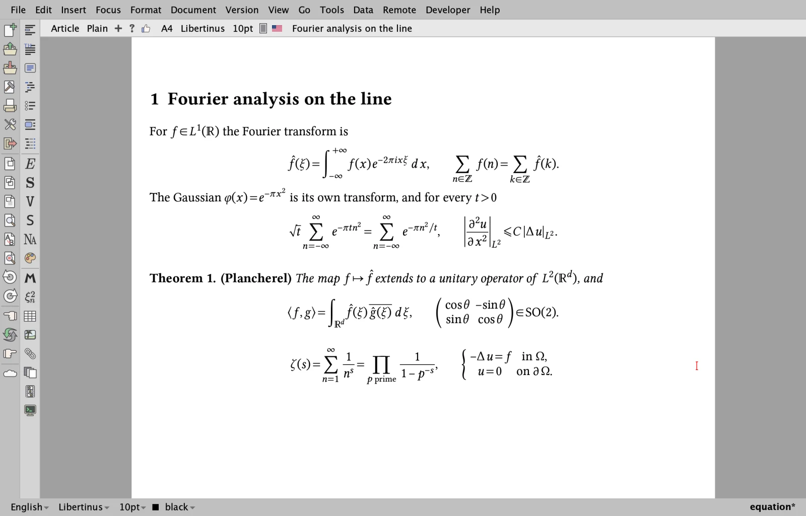
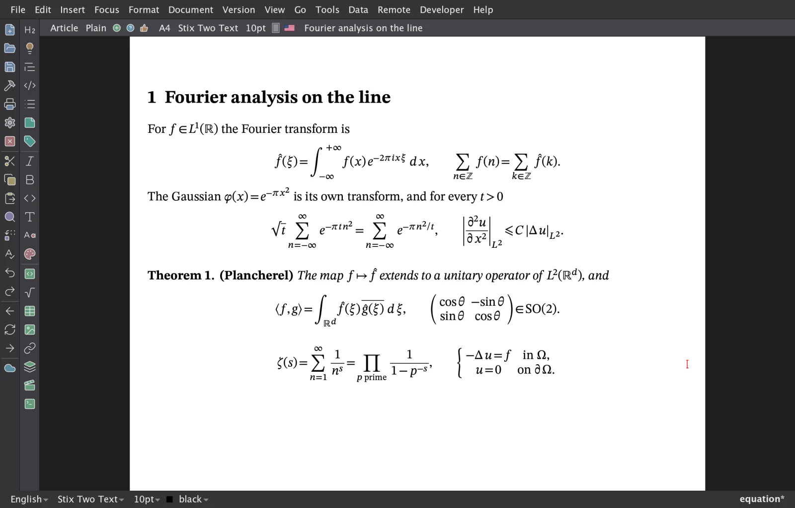
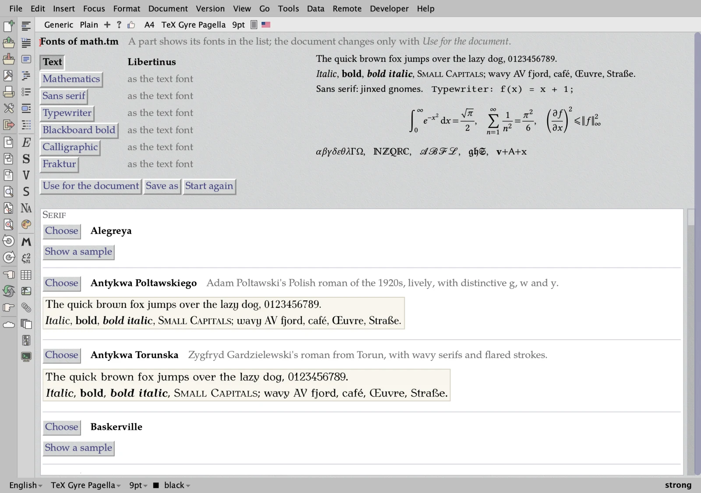
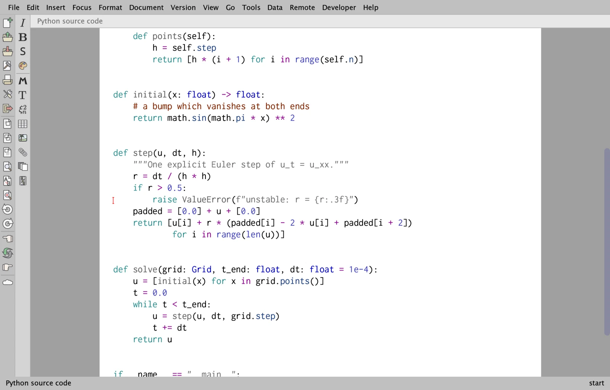
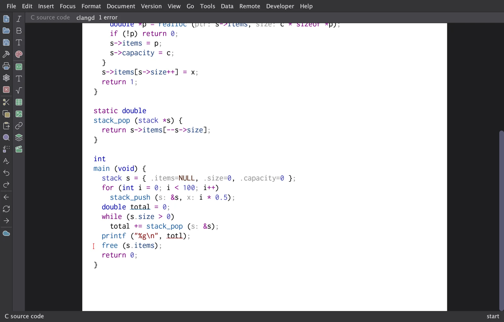
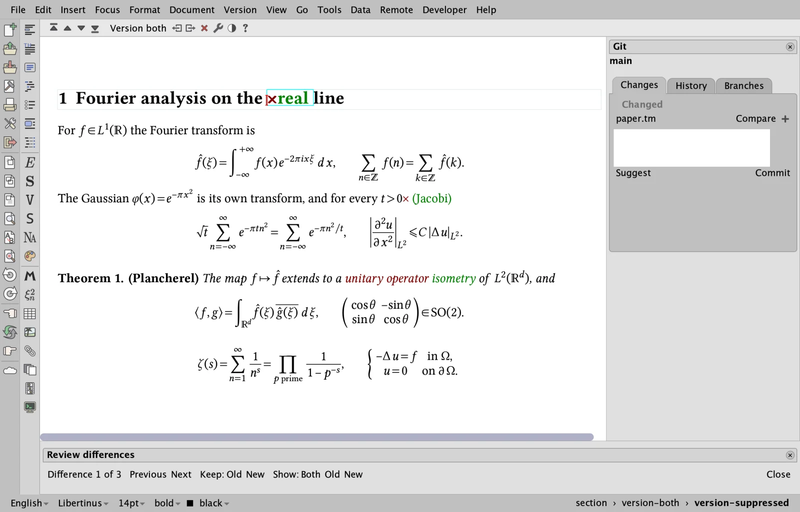
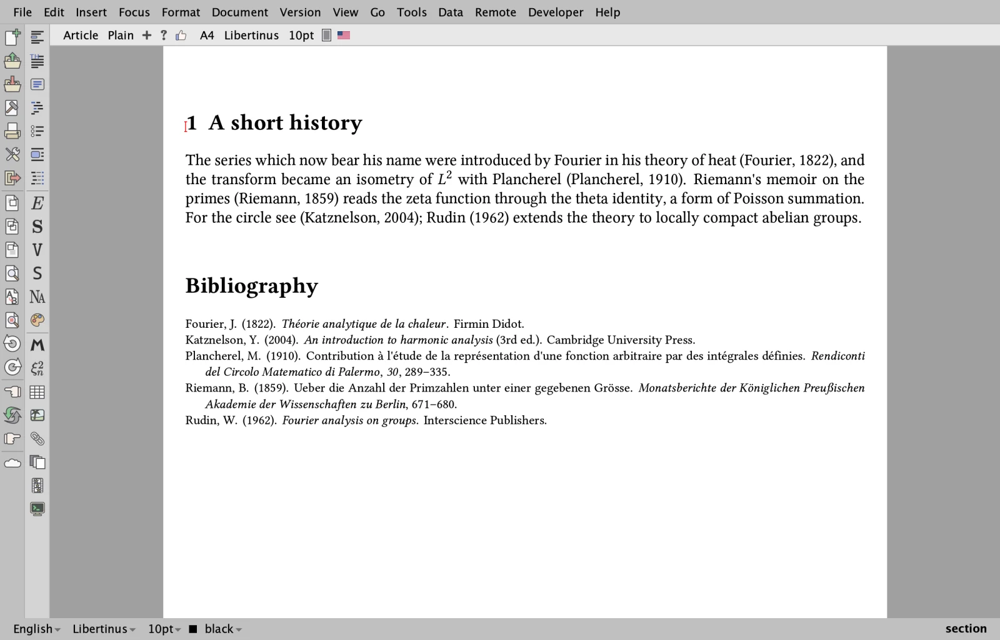
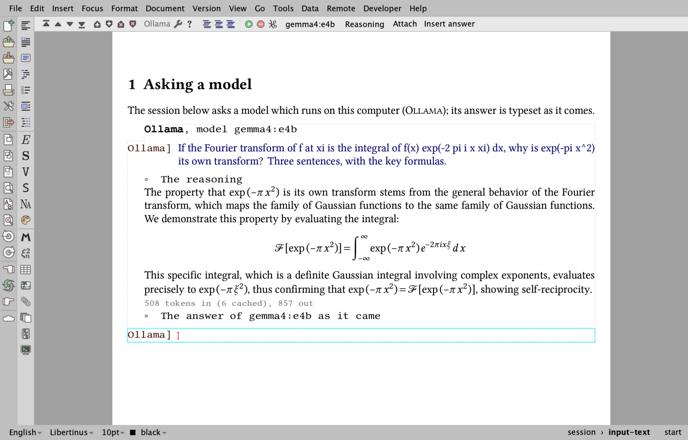
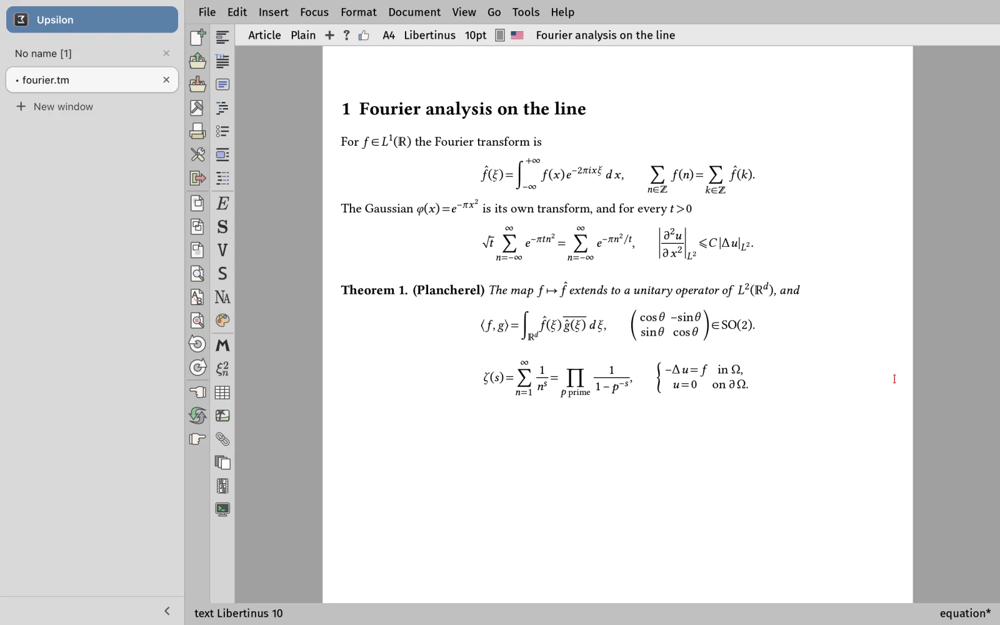

# TeXmacs Upsilon in pictures

Screenshots of some of what TeXmacs Upsilon adds to
[GNU TeXmacs](https://texmacs.org); the [README](../README.md) lists
everything. The same pictures are on the site, at
**<https://mgubi.github.io/texmacs/features.html>**, with the
[latest builds](https://mgubi.github.io/texmacs/downloads.html) and
[TeXmacs in the browser](https://mgubi.github.io/texmacs/).

The pictures are in [`src/misc/upsilon/screenshots`](../src/misc/upsilon/screenshots)
(WebP, 1600 pixels wide); they were taken in the Vue interface on macOS
and in Firefox.

## OpenType mathematics

Formulas are laid out from the `MATH` table of any OpenType math font,
with the stretchable delimiters and accents of the font itself. Some two
dozen math fonts are paired with their text companions, most of them
shipped with TeXmacs; here Libertinus.

## Interfaces, themes and icons

The same page in STIX Two, in the Vue interface with its dark theme and
the Lucide icons. Besides Qt, TeXmacs Upsilon can be built with Vue, an
interface drawn by the GPU, and with a native Cocoa interface for macOS;
four icon sets come along.

## Font design

A page with a tab for each part of a document (text, mathematics, sans
serif, typewriter, blackboard bold, calligraphic, fraktur) shows samples
of the fonts, applies a choice to the document and saves named choices.
More fonts come along: DejaVu, Gentium Plus, the Antykwas, Iwona, the
weights of IBM Plex...

## Program code with tree-sitter

The syntax of 22 languages, by tree-sitter, in source files, in the code
blocks of documents and in the inputs of sessions: colours, folds, an
outline, selection and moves by structure, brackets, indentation and
comments. Source files are saved exactly as they were loaded.

## Language servers

Source files are followed by the language server of their language when it
is installed, here clangd for C: diagnostics, completion, information on
hover, references, renaming, fixes and formatting; a code block of a
document is a document of its server too.

## Git

The Version menu works with Git: a side panel, commits, the history,
branches, the synchronization with a remote, and the comparison with any
revision, marked in the typeset document. Merges of TeXmacs documents
follow their structure.

## Citation styles and Zotero

The styles of the Citation Style Language (those of Zotero, Mendeley and
Pandoc) are processed by TeXmacs itself: here APA, for the citations and
the bibliography. References can also come from the Zotero application.

## AI sessions

Chats with ChatGPT, Claude, Gemini, Mistral, OpenRouter, Albert or a model
on your computer (Ollama, here gemma4) inside a document: the answers are
streamed and typeset as they come, files can be attached, and the keys are
kept in an encrypted wallet.

## In the browser

The same TeXmacs, compiled to WebAssembly, runs in a web page with nothing
to install: <https://mgubi.github.io/texmacs/>. Documents stay in the
browser, and Python, R, TikZ and Asymptote run in the page too.

