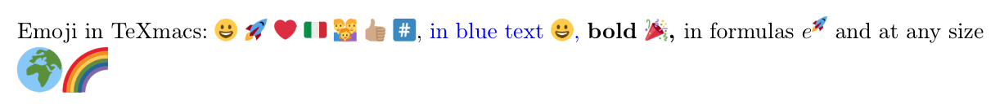

# Emoji and color fonts

TeXmacs draws the emoji in color with a font which comes with it,
**Twemoji Mozilla** (`TeXmacs/fonts/truetype/twemoji`), on every platform
and in the browser, so that a document looks the same everywhere. The
fonts keep one treatment on all the interfaces: the glyphs come from
FreeType and are drawn by the renderers of TeXmacs, not by the system.

## The formats of color fonts

| Format | A glyph is | Main fonts | In TeXmacs |
|---|---|---|---|
| COLR version 0 + CPAL | layers of ordinary outlines, each in a color of the palette | Twemoji Mozilla, Segoe UI Emoji | **drawn** |
| COLR version 1 | a graph of outlines with gradients, transforms and blending | Noto Color Emoji (new builds), Nabla | one color (the union of the outlines, if any) |
| sbix | a PNG at several sizes | Apple Color Emoji | not drawn |
| CBDT/CBLC | a PNG or a bitmap at several sizes | Noto Color Emoji (Android, Linux) | not drawn |
| SVG in OpenType | an SVG document per glyph | some Adobe fonts | not drawn |

FreeType reads all of them: `FT_Get_Color_Glyph_Layer` and
`FT_Palette_Select` for COLR version 0 (since FreeType 2.10), with
`FT_LOAD_COLOR` the bitmaps of sbix and CBDT, `FT_Get_Color_Glyph_Paint`
the graph of COLR version 1 (which it does not draw), and the SVG through
hooks.

## How an emoji is typeset

1. **The text.** The typesetter cuts a string into pieces (the `advance`
   of the languages, `System/Language/text_language.cpp`); a symbol is a
   piece of its own. `emoji_sequence_end` (`language.cpp`) keeps a
   sequence in one piece: an emoji with the variation selectors, the skin
   tones, the tags and the keycap after it, the emoji joined by U+200D, and
   the two regional indicators of a flag; `keycap_at` does it for a digit,
   `#` or `*` followed by U+FE0F and U+20E3.
2. **The font.** `smart_font_rep::resolve` (`Graphics/Fonts/smart_font.cpp`)
   takes the characters which are emoji by default (`is_emoji_presentation`,
   the property Emoji_Presentation of Unicode) and the marks of the
   sequences (`is_emoji_mark`) from the emoji font, before any other font:
   some text fonts have a few emoji in black and white. A symbol which is
   text by default, like the heart U+2764, keeps the font of the text, but
   goes to the emoji font when U+FE0F follows it (`emoji_before_selector`,
   in `advance`), or when no other font has it (at the end of `resolve`).
3. **The sequences.** In the emoji font a sequence is a ligature of the
   GSUB feature `ccmp` (`parse_gsub_ligatures`, `Plugins/Freetype/tt_tools.cpp`,
   GSUB lookups of type 4); `unicode_font_rep::read_glyph` reads the
   longest ligature which starts at a character, wherever the font reads
   its glyphs (extents, positions, drawing). What is left of a sequence
   which is not a ligature of the font (a selector after a letter, a
   joiner between two emoji which make nothing together) is not drawn and
   takes no room (`is_emoji_mark` in `tt_face.cpp` and `unicode_font.cpp`).
4. **The metrics.** The base glyph of a COLR glyph is often empty: the
   metrics are those of its layers (`tt_font_metric_rep::get`), and its
   bitmap, for whatever asks for one, is their union in one color
   (`color_glyph_union`).
5. **The drawing.** `unicode_font_rep::draw_color_glyph` draws the layers
   from the bottom up, each as an ordinary glyph of the same font (a
   native glyph, `0xc000000` plus its index) with the pen set to its color
   (the color of the text where the palette says so, and the opacity of
   the text for all of them). Every renderer thus draws an emoji as it
   draws text, and a PDF keeps it as vectors. Seen so far: the screen of
   Vue (as `TEXMACS_VUE_SNAPSHOT` saves it), the PDF of the MuPDF writer
   (`TEXMACS_PDF_MUPDF=1` or the preference `native pdf renderer`, and
   always in the browser), where the font is embedded as a subset, and
   the PostScript export (with its PDF through Ghostscript, where the
   glyphs become Type 3 fonts); the screens of Cocoa and Qt and the PDF of
   PDFHummus are still to be looked at.

## Not done yet

- **The bitmap formats (sbix, CBDT)**, to use the emoji fonts of the
  systems instead of the shipped one: FreeType gives them as BGRA bitmaps,
  which the renderers would draw as pictures (`draw_picture`), and a PDF
  would keep as images.
- **COLR version 1**: its graph turned into an SVG fragment per glyph and
  drawn by the SVG renderer (resvg or ThorVG), or only its solid fills.
- **The cursor** can stand inside a sequence: the characters of a ligature
  are all at the left of its picture (`get_xpositions`), and a key moves
  over them one by one.
- **The PDF of PDFHummus** (the Qt builds) is not checked yet: the layers
  are written as text of the font, which should also keep them searchable
  through the first layer.
- **Copy from a PDF**: the glyphs of the layers are in no character map
  of the font, so that the text taken from the PDF of the MuPDF writer has
  U+FFFD for each emoji; the first layer should carry the characters of
  the emoji (or of its sequence), and the others none.
- A choice of another emoji font (a preference): the font is
  `SHIPPED_EMOJI_FONT` in `smart_font.cpp`.

## Checks

The suite `emoji` (`TeXmacs/progs/check/emoji-test.scm`) checks the widths:
an emoji is one em (Twemoji draws every emoji in one em), a sequence is one
emoji, what is left of a sequence takes no room; a character which no font
has is written out as its code, several em wide.
