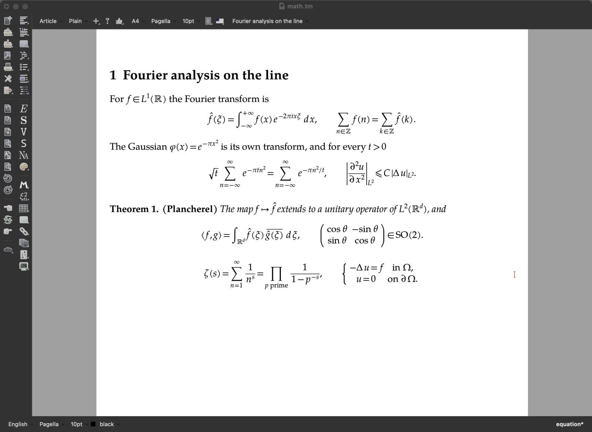

# TeXmacs Upsilon in pictures

Screenshots of some of what TeXmacs Upsilon adds to
[GNU TeXmacs](https://texmacs.org); the [README](../../README.md) lists
everything. The same pictures are on the site, at
**<https://mgubi.github.io/texmacs/features.html>**, with the
[latest builds](https://mgubi.github.io/texmacs/) and
[TeXmacs in the browser](https://mgubi.github.io/texmacs/texmacs.html).

The pictures are in [`src/misc/upsilon/screenshots`](../misc/upsilon/screenshots)
(WebP, 1600 pixels wide); they were taken in the Vue interface on macOS
and in Firefox.

1. [OpenType mathematics](#opentype-mathematics)
2. [Interfaces, themes and icons](#interfaces-themes-and-icons)
3. [A native Cocoa interface](#a-native-cocoa-interface)
4. [Font design](#font-design)
5. [Faster typesetting](#faster-typesetting)
6. [Three Scheme interpreters](#three-scheme-interpreters)
7. [Program code with tree-sitter](#program-code-with-tree-sitter)
8. [Language servers](#language-servers)
9. [Git](#git)
10. [Citation styles and Zotero](#citation-styles-and-zotero)
11. [AI sessions](#ai-sessions)
12. [In the browser](#in-the-browser)

## OpenType mathematics

Formulas are laid out from the `MATH` table of any OpenType math font,
with the stretchable delimiters and accents of the font itself. Some two
dozen math fonts are paired with their text companions, most of them
shipped with TeXmacs; here Libertinus.

## Interfaces, themes and icons

The same page in STIX Two, in the Vue interface with its dark theme and
the Lucide icons. Besides Qt, TeXmacs Upsilon can be built with Vue, an
interface drawn by the GPU, and with a native Cocoa interface for macOS;
four icon sets come along.

## A native Cocoa interface

On macOS, TeXmacs Upsilon also comes as a native Cocoa application: the
menus in the menu bar of the Mac, the bars and the dialogs of macOS, the
documents drawn by the GPU (Metal). Here with the dark theme and TeX Gyre
Pagella.

## Font design

A page with a tab for each part of a document (text, mathematics, sans
serif, typewriter, blackboard bold, calligraphic, fraktur) shows samples
of the fonts, applies a choice to the document and saves named choices.
More fonts come along: DejaVu, Gentium Plus, the Antykwas, Iwona, the
weights of IBM Plex...

## Faster typesetting

An edit in a long document costs about as much as the paragraph it
touches: what an edit did not change is used again (the reuse follows what
each part of the document read from its environment), the page breaks are
not searched again when the sizes stay, and the labels of the table of
contents and of the index no longer renumber everything after them. What
is typeset is the same, byte for byte. The time of one edit in the middle
of the user manual (Help → Manual, 290 pages):

| Edit | Standard TeXmacs | TeXmacs Upsilon |
|---|---:|---:|
| type a letter | 283 ms | 17 ms |
| Return (a new paragraph) | 306 ms | 39 ms |
| Backspace (two paragraphs joined) | 854 ms | 16 ms |
| a new section | 1355 ms | 62 ms |
| a new numbered equation | 872 ms | 44 ms |
| type in the equation | 317 ms | 36 ms |

The typesetting time of each edit, without the repaint, from
`TEXMACS_EDIT_PROFILE`; Qt and Guile 1.8 on both sides, macOS on an Apple
M4, medians of 3 runs. Standard TeXmacs is the official sources with the bug
fixes of this repository, which do not change the typesetting. Typing 30
letters in the middle of the reference of the Scheme functions takes 39 ms
instead of 257. Details: [pull request #333](https://github.com/mgubi/texmacs/pull/333).

## Three Scheme interpreters

TeXmacs is programmed in Scheme, on Guile 1.8. TeXmacs Upsilon runs on
[S7](https://ccrma.stanford.edu/software/snd/snd/s7.html) (the default, and
the one of the browser) and on
[femtolisp](https://github.com/JeffBezanson/femtolisp) too, chosen when
TeXmacs is built (`./configure --with-scheme=s7|femtolisp|guile`); one
Scheme code base serves the three. Where Scheme does the work, S7 and
femtolisp are several times faster; in the interactive work the time is
that of the C++ of TeXmacs, the same with all three.

| | Guile 1.8 | S7 | femtolisp |
|---|---:|---:|---:|
| a bibliography of 300 references in a style of CSL, three times | 6.3 s | 3.6 s | 1.75 s |
| a document to LaTeX | 2.4–3.9 s | 0.70 s | 0.55 s |
| a document to Markdown | 0.7–1.1 s | 0.07 s | 0.18 s |
| a Word document (.docx) read | 0.47–0.64 s | 0.19 s | 0.16 s |

macOS on an Apple M4, the three on the same machine and the same
documents. The first window is ready after about 0.7 s with S7 against
1.9 s with Guile (femtolisp: about 0.1 s more than S7). Details:
[the benchmarks of the converters and of CSL](femtolisp/11-benchmarks-csl-converters.md)
and [S7 against Guile](s7/07-performance.md).

## Program code with tree-sitter

The syntax of 22 languages, by tree-sitter, in source files, in the code
blocks of documents and in the inputs of sessions: colours, folds, an
outline, selection and moves by structure, brackets, indentation and
comments. Source files are saved exactly as they were loaded.

## Language servers

Source files are followed by the language server of their language when it
is installed, here clangd for C: diagnostics, completion, information on
hover, references, renaming, fixes and formatting; a code block of a
document is a document of its server too.

## Git

The Version menu works with Git: a side panel, commits, the history,
branches, the synchronization with a remote, and the comparison with any
revision, marked in the typeset document. Merges of TeXmacs documents
follow their structure.

## Citation styles and Zotero

The styles of the Citation Style Language (those of Zotero, Mendeley and
Pandoc) are processed by TeXmacs itself: here APA, for the citations and
the bibliography. References can also come from the Zotero application.

## AI sessions

Chats with ChatGPT, Claude, Gemini, Mistral, OpenRouter, Albert or a model
on your computer (Ollama, here gemma4) inside a document: the answers are
streamed and typeset as they come, files can be attached, and the keys are
kept in an encrypted wallet.

## In the browser

The same TeXmacs, compiled to WebAssembly, runs in a web page with nothing
to install: <https://mgubi.github.io/texmacs/texmacs.html>. Documents stay in the
browser, and Python, R, TikZ and Asymptote run in the page too.

